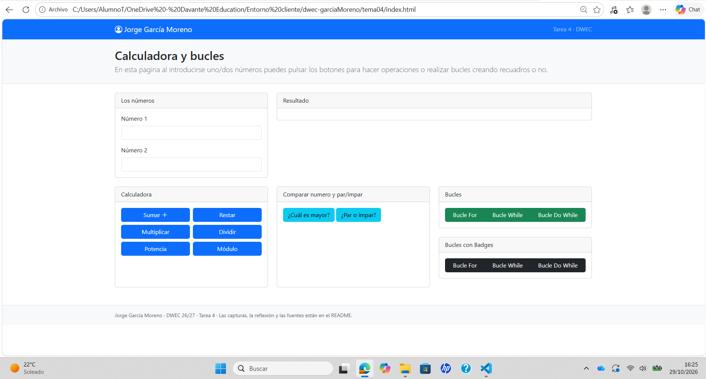
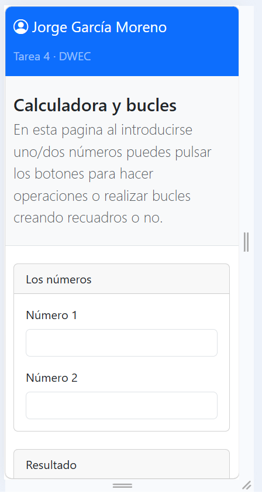
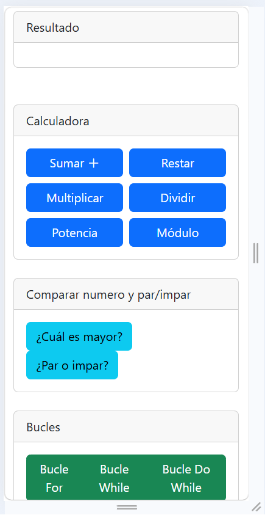
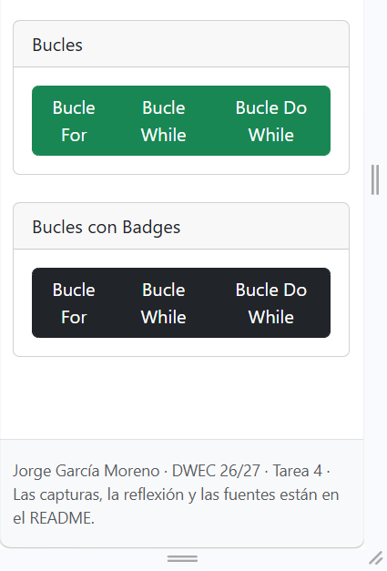
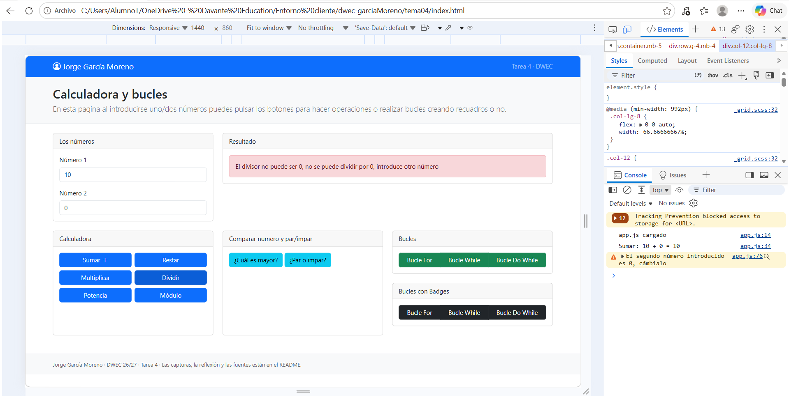
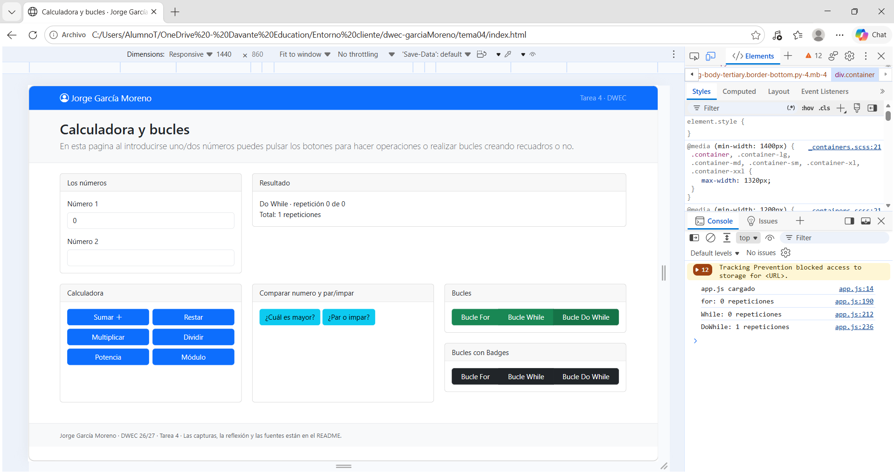
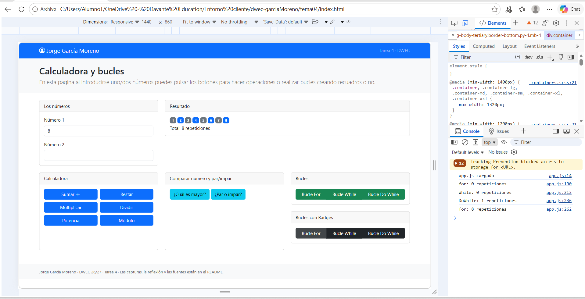

# Tarea 4 · Calculadora y bucles

**Autor:** Jorge García Moreno · Desarrollo Web en Entorno Cliente (DWEC) · 2.º DAW · Curso 2026-27

En esta carpeta hay un index.html en el que se piden dos números, se ofrecen varios botones para poder ejecutar operaciones de una calculadora y, utilizando el número 1, se itera un número de veces. Las funciones de las operaciones y bucles estan en app.js y las funciones de utilidad en ayudas.js

## Capturas

### a) La página entera

Aqui se ve mi nombre en el navbar y como he estructurado toda la página, la parte de los botones la he estructurado en un row de 4, para que me ocupe todo el tamaño de la página.

### b) La página en el móvil

Lo pongo en 3 imágemes porque no me cabe todo, pero cada parte viene estructurada más en vertical y se amontonan poco a poco la parte de los números y el resultado, luego las operaciones de calculadora y luego los bucles

### c) El error de dividir entre 0

En la página se muestra un mensaje de error comentando que se cambie el segundo número ya que no se puede dividir por 0

### d) Los tres bucles con el número 0

Los dos primeros bucles no se repiten ninguna vez, ya que la fase de la comprobación se realiza antes del código, el bucle DoWhile se ejecuta una vez, ya que se realiza su parte ANTES de la comprobación. 

### e) Un bucle con badges

He elegido que se realicen 8 iteraciones, como colores he elegido el azul claro del primary y luego el gris del secondary.

## Reflexión
El bucle for se diferencia del while y del do...while en que utiliza desde el principio un contador/iterador, de esta manera se repite el bucle un número determinado de veces, el bucle while primero se comprueba una condición y una vez pasada, se ejecuta el código repetido y el do...while, primero se realiza una vez la operación y luego se pasa a la condición. En ambos bucles tuve que crear dos variables, una para ir iterando y sumandose y otra para realmente contar el número de repeticiones, en el for y en el while no entran de primeras, ya que la comprobación se realiza antes de ejecutar esa parte del código mientras que en el bucle do...While al realizarse primero la iteración, el contador de iteraciones se incrementa en 1 directamente.

## Fuentes

- Documentación de Bootstrap(https://getbootstrap.com/docs/4.0/getting-started/introduction/)

## Uso de IA
He usado claude (Opus 5.5) de forma general para la realización de la práctica. La he usado hora de saber si me faltaban algunas partes, cuando me he quedado parado sin conocer cómo puedo ordenar mi index.html mediante bootstrap y conocer si hay algunos apartados de la rúbica que me haya saltado y no haya visto.