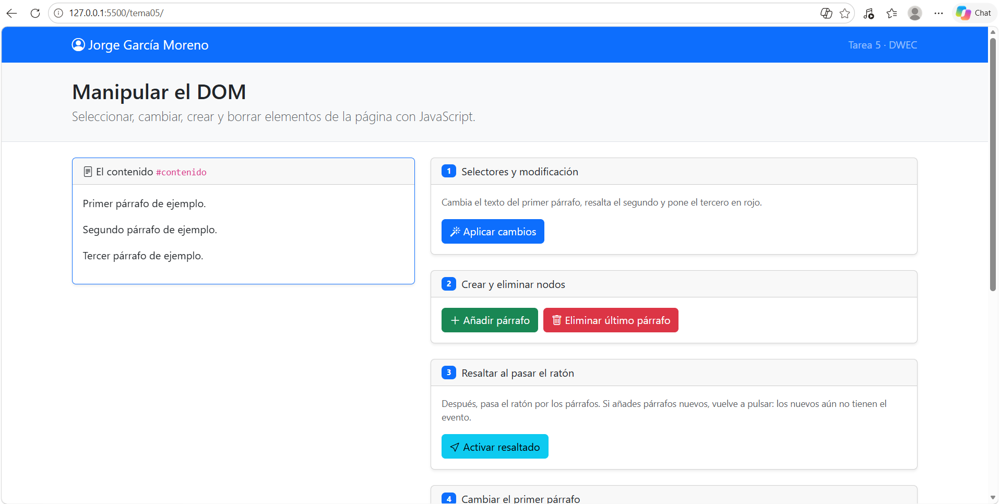
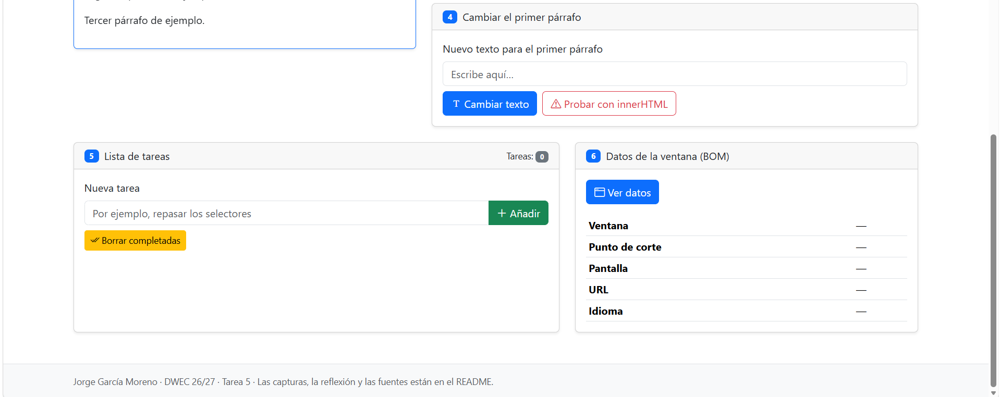
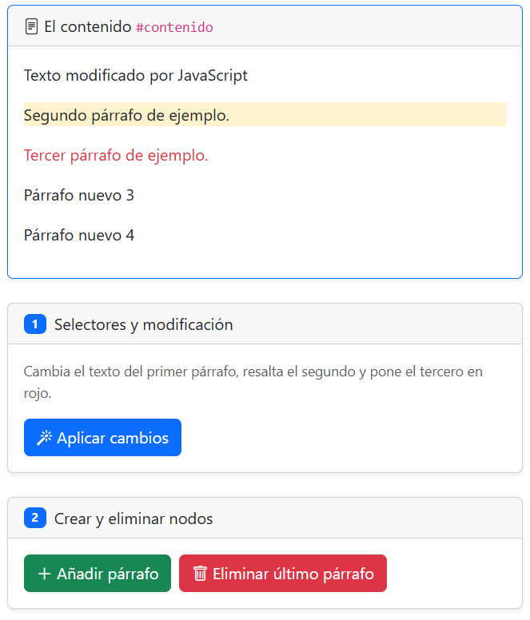
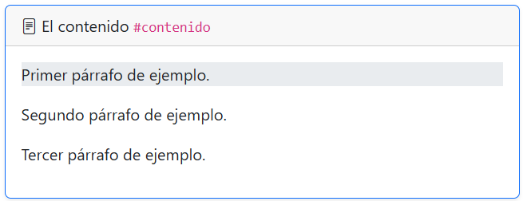
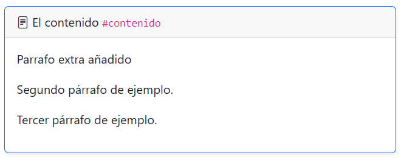
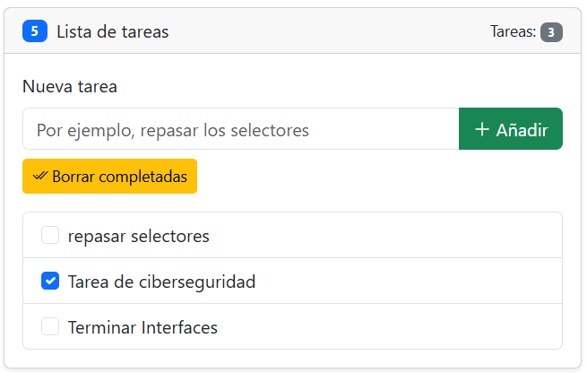
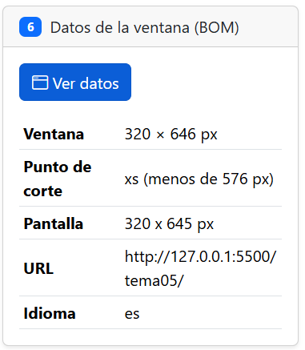

# Tarea 5 · Manipular el DOM

**Autor:** Jorge García Moreno · Desarrollo Web en Entorno Cliente (DWEC) · 2.º DAW · Curso 2026-27

En esta carpeta se encuentra el contenido correspondiente a la práctica 7 de Desarrollo Web en Entorno cliente, dentro de ésta se encuentra el index.html que es la página que permite visualizar cada uno de los apartados correspondientes a los ejercicios de estas práctica. Para ejecutarlo: hay que abrir la carpeta en VS Code, pulsar Go Live y probar los botones con la consola abierta.

## Capturas

### a) La página recién cargada

Aqui aparece mi nombre y los parrafos de cada ejercicio con su enunciado y sus botones.

### b) Ejercicios 1 y 2

Después de darle al botón el primer parrafo tiene un texto nuevo, el segundo se resalta en amarillo usando bg-warning-subtle y el tercero está en rojo usando text-danger. Debajo se puede ver dos textos que los añado usando createElement y append.

### c) Ejercicio 3: resaltado al pasar el ratón

El primer párrafo se ve resaltado ya que mantengo el cursor encima de éste, cuando lo muevo vuelve al estado que estaba, igual que los demás párrafos. Los párrafos que añado a posteriori no se resaltan hasta que se vuelve a pulsar el boton, ya que lo he realizado usando querySelectorAll, el cual devuelve los párrafos que existen en ese momento.

### d) Ejercicio 4: `<b>hola</b>` con innerHTML

Antes de darle al botón añadiendo el nuevo texto para el párrafo, ponía: "Primer párrafo de ejemplo", después de eso, al escribir el texto se sustituye el contenido del primer párrafo por el nuevo.

### e) Ejercicio 5: la lista de tareas

Aqui se puede observar como he añadido tres tareas tras escribir el texto y darle al botón de añadir una por una, después marco una como terminada clickando en el checkbox.
Al clickar en "Borrar completadas" todas las que tengan el checkbox marcado se borran, eliminando su <li> y bajando el contador de tareas.

### f) Ejercicio 6: los datos de la ventana en el móvil

El punto de corte es xs = menor de 576 px (móvil), los píxeles, la URL y el idioma del navegador.

## Reflexión

Pues textContent trata lo que le das como texto: si contiene etiquetas, las muestra tal cual, sin embargo, innerHTML lo interpreta como HTML y crea los elementos de verdad. Lo comprobé con <b>hola</b> con textContent se veían las etiquetas y con innerHTML salía "hola" en negrita. No se debería de meter porque proporciona vulnerabilidad, ya que alguien podría escribir HTML con código Javascript dentro y el navegador lo ejecutaría (ataque XSS)

## Fuentes

- El PDF de los apuntes del temario proporcionados por el profesor.

## Uso de IA

He usado Claude, concretamente Opus 5.5 para realizar la práctica. Le he estado preguntando una vez que había terminado cada ejercicio hecho por mí si me faltaba algo de lo que se me pedía realizar y cuando me atrancaba en algún punto que me echase una mano a encontrar la solución y a darme pistas de lo que habia que realizar. Todo esto exceptuando la parte del ejercicio 6, en donde no comprendía cómo podía estructurar la parte de mostrar la información de la ventana con respecto a los píxeles.