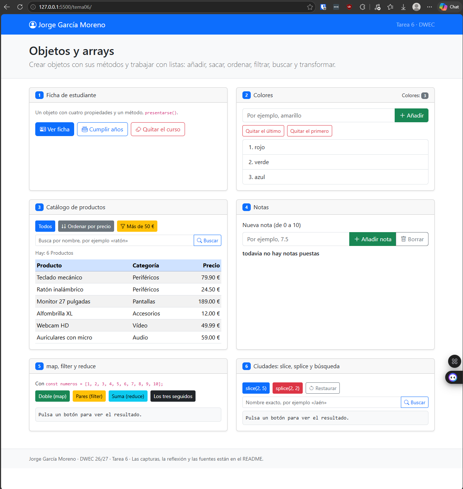
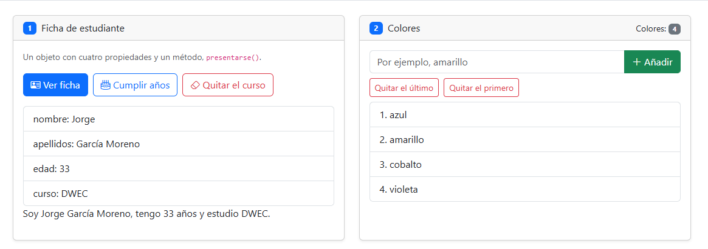
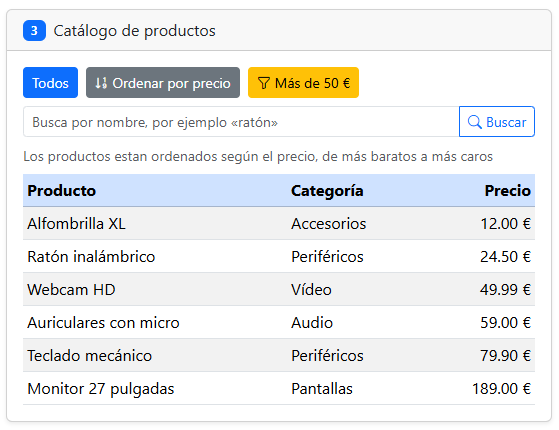
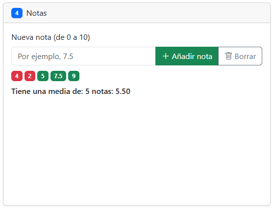
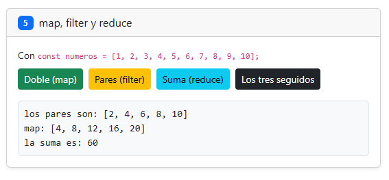
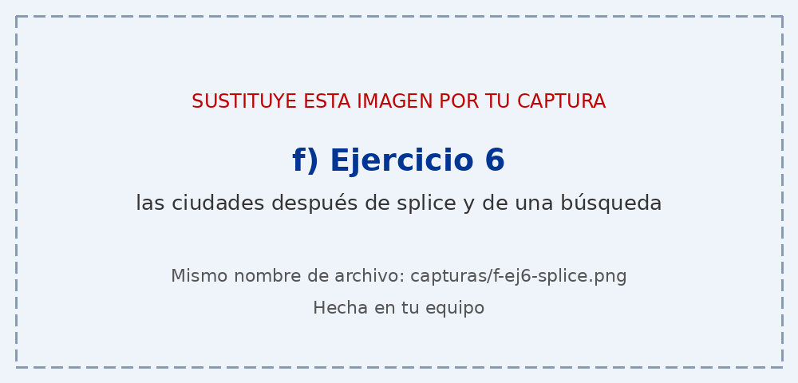

# Tarea 6 · Objetos y arrays

**Autor:** Jorge García Moreno · Desarrollo Web en Entorno Cliente (DWEC) · 2.º DAW · Curso 2026-27

[Una o dos líneas: qué hay en esta carpeta y cómo se ve. Por ejemplo: abrir la carpeta en VS Code, pulsar **Go Live** y probar los botones con la consola abierta (F12).]
En esta carpeta hay un index.html que sirve para mostrar al usuario la práctica, este README.md explicando todo lo correspondiente a las funciones de app.js, una carpeta js con un archivo app.js con las funcionalidades que se me piden aplicar y una carpeta capturas con cada una de las capturas del index.html habiendo aplicado cada uno de los botones con mis funcionalidades.

## Capturas

### a) La página recién cargada

En esta página se puede ver mi nombre en un navbar junto con la tarea a la que corresponde. Cada uno de los bloques corresponde a un ejercicio en concreto: En el primer bloque tengo mi ficha de alumno. En el segundo un array de colores en el que puedo añadir y quitar el primero o el último. En el tercero un array objetos producto con distintos atributos que puedo ordenar por precio, buscar entre ellos por nombre o mostrar los que valen mas de 50 €. En el cuarto puedo añadir valores numéricos (notas) que puedo meter en otro array o borrar a gusto y en el quinto un map de numeros con los que juego con ellos.

### b) Ejercicios 1 y 2: la ficha y los colores

Muestro la lista habiéndome añadido algunos años y añadiendo y quitando algunos colores. En el ejercicio 1 he utilizado el metodo delete para borrar la propiedad entera, no solo el valor, por eso sale undefined cuando lo muestro. Utilizo append para añadir al final en el array de colores y pop y shift para quitar el ultimo y el primero respectivamente.

### c) Ejercicio 3: el catálogo ordenado por precio

Mi funcion de comparación realmente crea una copia de la lista de productos y la ordena mediante la función sort. Esta función ordena según una función anónima que defino, establece que dados dos elementos: a y b decido cuál va primero. Funciona dandole un valor numérico, negativo si "a" va el primero o positivo si "b" va el primero.

### d) Ejercicio 4: las notas y la media

Añado los números uno a uno y no me permite escribir sino es texto, realmente utilizo funciones como push para meterlo en el array y reduce para calcular la media. Cuando tienen un valor por debajo de 4 les pongo un badge de color rojo y si es 5 o superior verde, de las clases predefinidas de bootstrap5.

### e) Ejercicio 5: los tres métodos seguidos

Realmente, en los tres seguidos se ejecuta la funcionalidad de los otros 3 métodos pero sobre el resultado de los anteriores. Primero, aplico la función filter, que me devuelve los elementos a un nuevo array que cumplen la especificación que les doy (que el resto de dividir por 2 sea 0, osea, que sean pares). Después, al resultado de este nuevo array utilizo la función map que devuelve el mismo array que le paso pero con una operacion / función aplicada a cada elemento, que es multiplicar por 2 el valor de cada elemento del array. Despues a ese array resultado le aplico otra función que es sumar cada valor del array en una variable y la muestro. Una vez aplicada cada función modifico cada parte del div con id = salida5 y añado un div nuevo correspondiente a una linea nueva con cada parte del resultado de esas funciones.

### f) Ejercicio 6: después de splice y de buscar una ciudad

[Qué ciudades ha quitado splice, en qué posición ha quedado la que has buscado y por qué.]

## Reflexión

[De 5 a 8 líneas: ¿qué métodos de los que has usado cambian el array original y cuáles devuelven uno nuevo? Pon como ejemplo lo que pasa en el ejercicio 6 con slice y con splice, y explica por qué en el ejercicio 3 ordenas una copia.]
(no borro el comentario en [] ya que quiero modificarlo a posteriori para poder terminar el 6 aunque sea fuera de plazo.)
Los métodos que cambian el array original son: push, pop, shift, sort y splice(no usado hasta el 6).
Los métodos que devuelven un nuevo array son: slice, map y filter.
El ejercicio 6 no lo he realizado todavia.
En el ejercicio 3 ordeno una copia ya que sort modifica el array original, por lo que como me lo piden, lo hago de esa manera.

## Fuentes

- [Título de la página](https://enlace-a-la-fuente)

## Uso de IA

[Si has usado IA: qué herramienta, para qué y qué hiciste después con su respuesta. Si no la has usado, borra este apartado.]
He utilizado Claude, concretamente Opus 5.5 para poder comprobar los fallos que iba teniendo en los métodos una vez que los había hecho a mi manera, comprobaba los errores y luego veía si necesitaba realizar algún cambio de los que me daba y qué sugerencias me hacía, pero siempre escribiendolo por mi cuenta y enterándome de qué estaba realizando. De forma general le he pasado la rúbica de la tarea y mi ejercicio para comprobar si se me había escapado algo de lo que había realizado y de si me faltaba algún TODO por borrar.