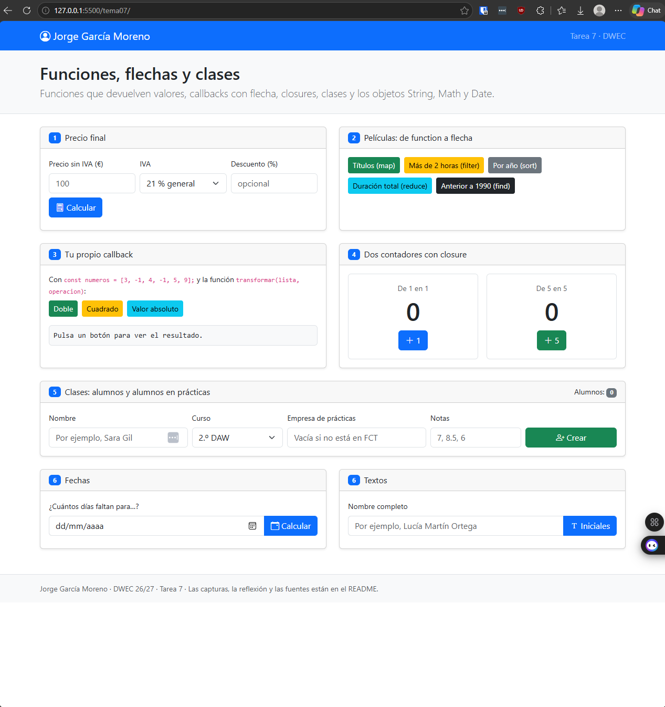
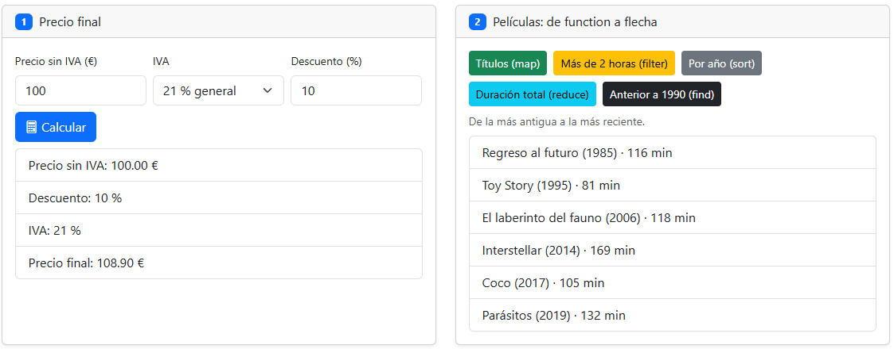
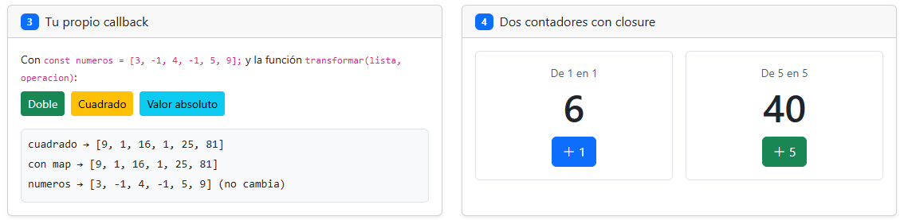
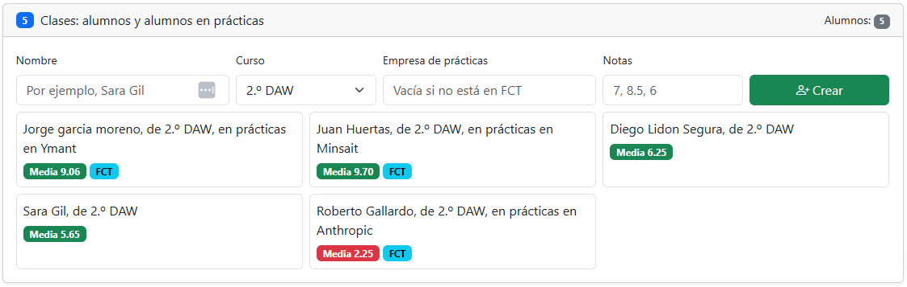
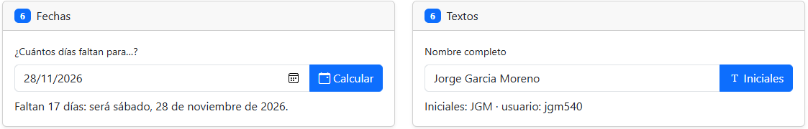

# Tarea 7 · Funciones, flechas y clases

**Autor:** Jorge García Moreno · Desarrollo Web en Entorno Cliente (DWEC) · 2.º DAW · Curso 2026-27

En esta carpeta se encuentra el contenido correspondiente a la práctica 7 de Desarrollo Web en Entorno cliente, dentro de ésta se encuentra el index.html que es la página que permite visualizar toda la funcionalidad que he tenido que realizar, este README, una carpeta con las capturas correspondientes que aparecen aqui más abajo y una carpeta js con un archivo js correspondiente a las funcionalidades de la página. Se puede observar todo ejecutando los botones e introduciendo los datos necesarios de cada bloque y abriendo la consola con F12.

## Capturas

### a) La página recién cargada

Aquí se puede ver mi nombre y cada uno de los bloques correspondientes a cada ejercicio.

### b) Ejercicios 1 y 2: el precio y las películas

[Un precio con descuento y uno de los botones de las películas. Qué hace calcularPrecio() y qué hace mostrarPrecio().]
calcularPrecio() calcula y devuelve el resultado correspondiente con el iva y con el descuento aplicadocon return, mientras que mostrarPrecio() lee las casillas, comprueba si ha habido algun error o si se ha equivocado al introducir el precio o el descuento y llama a calcularPrecio() para despues pintarlo con pintarLista.

### c) Ejercicios 3 y 4: tu callback y los contadores

transformar crea un array vacío y lo recorre con for...of, en donde con cada número perteneciente al array lo guarda en uno nuevo con push realizando la operación correspondiente.
Cada contador lleva su propia cuenta tal y como nos piden, cada llamada crearContador crea su propia variable cuenta y su propio paso, devolviendo los valores guardados dependiendo de quien la llama. Si escribimos cuenta en la consola sale un ReferenceError, ya que la variable cuenta solo existe dentro de crearContador.

### d) Ejercicio 5: los alumnos

Al crear un alumno, dependiendo del número de parámetros que utilizo a la hora de crear un nuevo objeto alumno, si le doy 3 parámetros (correspondiente a rellenar el atributo empresa) se crea un AlumnoFCT, sino, creo un Alumno.

### e) Ejercicio 6: fechas y textos

he probado el 28/11/2026, quedando 17 dias desde hoy. Redondeo debido a que al restar dos fechas salen milisegundos como resultado, usando Math.round se arregla.

## Reflexión

Se utiliza una nueva estructura, en vez de poner function al principio se pone => despues de los parámetros de entrada, también, si la expresión es solo una línea (return) se pueden evitar las llaves y el propio return.
La utilizacion de la flecha no permite usar referenciar al propio objeto (this), por lo que no puedo recoger sus variables cuando lo uso.

## Fuentes
- Los apuntes del tema 7 de la asignatura.
- [Funciones flecha](https://developer.mozilla.org/es/docs/Web/JavaScript/Reference/Functions/Arrow_functions)
- [información adicional de toLocalDateString](https://developer.mozilla.org/es/docs/Web/JavaScript/Reference/Global_Objects/Date/toLocaleDateString)

## Uso de IA
[Si has usado IA: qué herramienta, para qué y qué hiciste después con su respuesta. Si no la has usado, borra este apartado.]
He utilizado Claude Code (Opus 5.5) para que me haga un resumen del código proporcionado y para que me vaya ayudando cuando me he quedado atrancado en las tareas y para comprobar tras realizar cada ejercicio si me he saltado o me ha faltado alguna parte que no haya visto. Todo el código que he tenido que realizar, igualmente, ha sido escrito por mi mano.
En algunos apartados, en concreto en la parte de crear las iniciales del ejercico 6 he necesitado que me explicase paso a paso que voy obteniendo en la funcion para crear las iniciales del nombre como tal.
